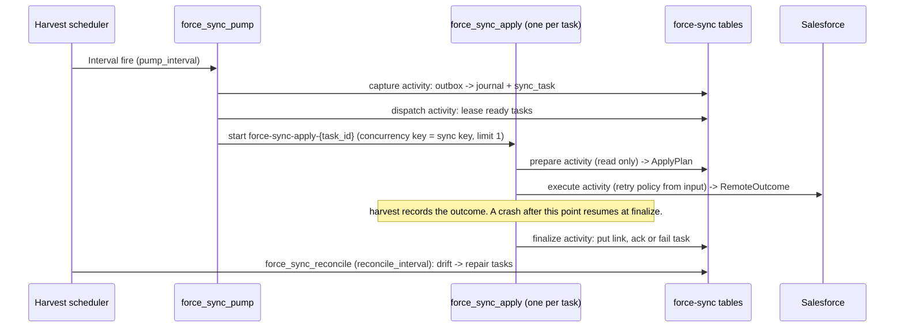

# ADR-036: Durable force-sync on autumn-harvest

**Status:** Accepted
**Date:** 2026-10-30
**Deciders:** Mark

## Context

`force-sync` ([ADR-026](026-force-sync-crate.md)) keeps all sync state in
Postgres: the outbox, the journal, the `sync_task` lease queue, links,
conflicts and dead letters. Its runtime is explicit. The caller loops over
`run_capture_postgres_once`, `run_apply_once` and `run_reconcile_once`.

That leaves gaps that every embedder has to fill alone:

- **No supervisor.** The caller owns the loops, their cadence, and making
  sure that only one process runs each loop.
- **Fixed, unbounded retry.** A transient Salesforce error puts the task back
  to `ready` 30 seconds later, forever. No backoff, no attempt cap.
- **A crash between the Salesforce write and the ack repeats the write.** The
  lease expires, another worker leases the task, and calls Salesforce again.
  External-ID upserts make this mostly harmless, but it is not recorded.
- **No ordering per record.** Two tasks for one record can run on two workers
  at once.
- **No execution history.** An operator sees `last_error` and nothing else.

[autumn-harvest](https://github.com/autumn-foundation/autumn-harvest) is a
Postgres-backed durable workflow engine: event-sourced workflows, activities
with retry policies and timeouts, schedules, and per-key concurrency limits.
It has the same single-Postgres footprint as force-sync.

## Decision

Add an opt-in `durable` feature to `force-sync` that runs the existing
pipeline as harvest workflows. The explicit runtime stays, unchanged.

### Apply in three phases

The apply code is split into three phases, shared by both runtimes
(`src/apply/steps.rs`):

1. **Prepare** reads the journal row and the link, runs the planner, and
   returns a serializable `ApplyPlan`. It writes nothing. The plan logic is a
   pure function (`plan_apply`) with its own unit tests.
2. **Execute** makes the one Salesforce call that the plan names and returns
   `Applied`, `Rejected` (permanent) or `Retry` (transient).
3. **Finalize** reloads the journal row and the link, writes the link, and
   acknowledges, retries or fails the task.

`run_apply_once` runs the three phases in one call. The durable runtime runs
each phase as an activity. Harvest records each result, so the Salesforce
call is never repeated after it is recorded.

### Invariants

- **A durable task never returns to `ready`.** Every apply workflow path ends
  in finalize, and finalize then marks the task `done` or `failed`. A failed
  prepare fails the task with `prepare failed: ...`. On the last attempt, the
  execute activity turns a transient error into a rejection
  (`Salesforce call retries exhausted: ...`). The workflow also maps a stray
  `Retry` outcome to a rejection. A task returned to `ready` would collide
  with the completed workflow that has its ID.
- **One workflow per task.** The workflow ID is `force-sync-apply-{task_id}`.
  The start uses `AllowDuplicateFailedOnly` with `UseExisting`. A task that is
  dispatched again after its lease expires attaches to a running workflow,
  and replaces a failed one. A task that attaches to a completed workflow is
  failed for an operator, so it cannot loop.
- **One apply in flight per record.** Each apply workflow carries its sync
  key, encoded as JSON `[tenant, object, external_id]`, as a harvest
  concurrency key with limit 1.
- **Retry policy is history.** The retry policy of the Salesforce call is in
  the workflow input, so a config change cannot change a run in flight.
- **force-sync tables stay the source of truth.** Harvest owns scheduling,
  retries and history only.

### Integration surface

- `DurableSync::new(engine, harvest_pool)` with `DurableSyncConfig`.
- `DurableSync::start()` runs a core harvest `Worker` on the `force-sync`
  queue and a `SchedulerRuntime`. It needs no autumn-web.
- `DurableSync::register(builder)` adds the workflows, activities, schedules
  and state to an existing `HarvestBuilder`, for apps that already run
  harvest, for example with `HarvestPlugin`.
- `migrate_harvest(url)` and `harvest_pool(url, size)` wrap the harvest
  migration and pool helpers.

## Alternatives considered

- **Replace `sync_task` with harvest.** Capture and reconcile write
  `sync_task` rows in the same transaction as the journal row. Keeping the
  table keeps that atomicity and the existing operator queries, and it leaves
  the explicit runtime working.
- **Depend on `autumn-harvest-plugin` and `HarvestRunner`.** It pulls in
  autumn-web. The core crate supports a direct embed, and `Worker::run` owns
  the timeout checker, notify registration and dispatch binding.
- **A git dependency on harvest 0.8.** `cargo deny` forbids git sources, and
  `force-sync` is published to crates.io. Version 0.7.0 on crates.io has every
  API used here.
- **Detached child workflows from the pump.** A detached child takes no
  caller-chosen workflow ID, so a re-dispatch could start a second run for one
  task.

## Consequences

- `durable` adds autumn-harvest and its tree (diesel, diesel-async) to
  `force-sync` builds that enable it. Default builds are unchanged.
- The feature needs Rust 1.88 or later, the autumn-harvest MSRV.
- The durable runtime assumes a single-shard harvest database (shard 0).
- Do not run the explicit runtime and the durable runtime on one store with
  one lease owner.
- The bulk lane no longer calls Bulk and then REST when the linked Salesforce
  ID is invalid. The planner now picks REST up front. The end state is the
  same, with one call instead of two.
- Salesforce CDC capture (`capture_stream`) is a long-lived stream. It is not
  scheduled by the durable runtime yet.

## Verification

- `src/apply/steps.rs`: 15 unit tests for the pure planner mapping.
- `src/durable/tests.rs`: config, schedules and queue wiring. Every workflow
  branch runs on harvest's `WorkflowTestEnv`, with a replay determinism check.
- `tests/durable_sync.rs` (Postgres, `--ignored`): a real worker and scheduler
  against wiremock. It covers the happy path, transient retry, retry
  exhaustion with the configured attempts, permanent rejection, two changes to
  one record, and a restart during finalize that does not repeat the
  Salesforce call.
