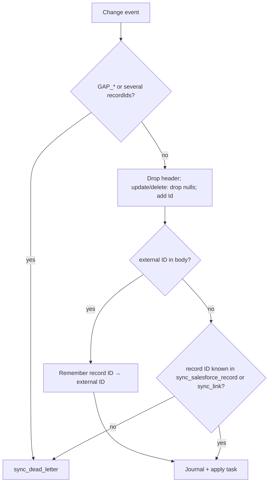

# ADR-037: Sparse Salesforce change events in force-sync capture

## Status

Accepted

## Context

force-sync keys every record by `[tenant, object, external_id]`. CDC capture
took the external ID from the event payload, `payload[external_id_field]`.

A Salesforce change event does not carry the whole record:

- A **create** or **undelete** event carries the field values of the record.
  A null field is a null value.
- An **update** event carries the changed fields. Every other field is null,
  the external ID included, unless the update changed it.
- A **delete** event carries no field values.
- The record ID is not a payload field. It is in
  `ChangeEventHeader.recordIds`.
- One event can name several records, when one transaction makes the same
  change to each of them.
- A **gap** event (`GAP_CREATE`, `GAP_UPDATE`, `GAP_DELETE`, `GAP_UNDELETE`,
  `GAP_OVERFLOW`) carries no field values. Salesforce sends it when it could
  not produce the normal event.

So capture sent almost every update and delete to `sync_dead_letter`, with
"no external ID". It also stored the header and the nulls in the journal.
The planner then saw each null as a change to null. An unchanged field with
a known value became a conflict, or a Salesforce-owned field was set to
null. The header itself differs on every event, so it conflicted too.

The mock tests did not show this, because their events carried the external
ID on every change. A live contract test against a real org was the follow-up
that found it.

## Decision

Capture reads each change event before it builds the envelope
(`read_cdc_event` in `capture/salesforce.rs`):

1. **The header leaves the body.** The journal stores record fields only.
   `changeType` sets the operation, and `recordIds` gives the record ID.
2. **An update or delete drops its nulls**, at every level, and an object with
   no field left goes too (a compound field such as `Name` on `Contact`). A
   null in such an event means "unchanged", so it must never overwrite a
   known value. A create keeps its nulls.
3. **The record ID joins the body as `Id`**, unless the body has an `Id`.
   The applied change then projects it onto `sync_link.salesforce_id`, which
   the existing Salesforce-origin projection already reads from `Id`.
4. **The key comes from the body when it can.** When the body has the
   external ID and the record ID, capture writes them to the new
   `sync_salesforce_record` table, in the same transaction as the journal
   row.
5. **Otherwise the key comes from the record ID.** Capture looks the record
   ID up in `sync_salesforce_record` first, then in `sync_link`, which knows
   records that were created from Postgres. The record map is written at
   capture time, so an update that follows a create in the same window
   resolves before the create is applied.
6. **The merged state of a record is stored.** A sparse journal row is not
   the whole record, but the planner read the last applied row as the
   current state. Every field outside it then looked new, so a conflicting
   change to it was accepted. An applied change now stores the merged
   payload in `sync_record_state`, and the planner reads that row first. It
   falls back to the last applied journal row for a record with no stored
   state.
7. **A delete is never a no-op.** A delete event carries no changed field,
   so its payload matches the current state. `plan_change` now plans a
   delete before the payload check, and the link gets its tombstone.
8. **What cannot be resolved is quarantined**, with the checkpoint moved past
   it, as before. That covers a gap event, an event that names several
   records, and a sparse event for a record that no earlier event or link
   knows. The new error `ForceSyncError::UncapturableCdcEvent` names the
   reason. The dead letter keeps the raw payload.

Migration 3 adds `sync_salesforce_record (tenant, object_name,
salesforce_id) → external_id`, `sync_record_state (tenant, object_name,
external_id) → payload`, and a partial index on
`sync_link (tenant, object_name, salesforce_id)`.

`ApplyPlan::ProjectLocal` now carries the merged payload. The field defaults
to `None`, so a plan recorded in durable workflow history before this change
still reads.

## Alternatives considered

- **An enriched custom channel.** Salesforce can add chosen fields to every
  event of a custom channel, so the external ID would always be present. It
  needs per-org setup, and it does not help a standard channel or a delete.
  It still works with this design: `CdcStream::with_topic` selects such a
  channel, and an enriched key takes the body path.
- **Query Salesforce for the external ID.** One REST call per sparse event of
  an unknown record. Capture runs in a database transaction per event, and a
  remote call there makes the window slow and its retries hard to reason
  about. The record map answers the same question locally.
- **Decode `changedFields` and `nulledFields`.** On the Pub/Sub API these
  header fields are bitmaps over the Avro schema field order. Decoding them
  would let capture keep an explicit null of an update. It needs the event
  schema at capture time, which `CdcSource` does not expose. Left as a
  follow-up.
- **Fan out an event with several records**, one journal row per record. The
  journal is unique on `(source, source_cursor)`, and the cursor is the replay
  ID, so the rows would collide. Left as a follow-up, quarantined meanwhile.

## Consequences

- Ordinary updates and deletes now reach the journal under the right key.
- An update that sets a field to null is not captured as a null. The field
  keeps its previous value until the next create, undelete or reconcile.
- An event that names several records is quarantined. A mass update with
  identical values can produce one. The dead letter keeps the record IDs, and
  a reconcile pass repairs the drift.
- A gap event is quarantined. It tells the operator to reconcile the record.
- A sparse event for a record that force-sync never saw is quarantined. This
  happens when a stream starts at `Latest` after the record was created. A
  backfill or a reconcile pass links such records.
- The journal no longer stores `ChangeEventHeader`.

## Verification

- `src/capture/salesforce.rs` unit tests: operations, header removal, record
  ID, null stripping at every level, a payload `Id` wins, and gap and
  multi-record events are uncapturable.
- `tests/cdc_window.rs` (Postgres), with events shaped as Salesforce sends
  them: a sparse update after a create in the same window, an update of a
  record that only a link knows, a delete, an unknown record, a multi-record
  event, a gap event, and a create whose apply links the record ID.
- `tests/cdc_window.rs` apply tests: a sparse delete of an applied record
  tombstones its link, and a change to a field that only the stored record
  state knows is still a conflict.
- `src/plan.rs`: a delete that matches the current state is not a no-op.
- `tests/live_cdc.rs` (live, ADR-033 tier `SF_SYNC_CDC`): a real create,
  sparse update and delete through `run_cdc_window` and through the durable
  `with_cdc` runtime, with the link and its tombstone checked.
